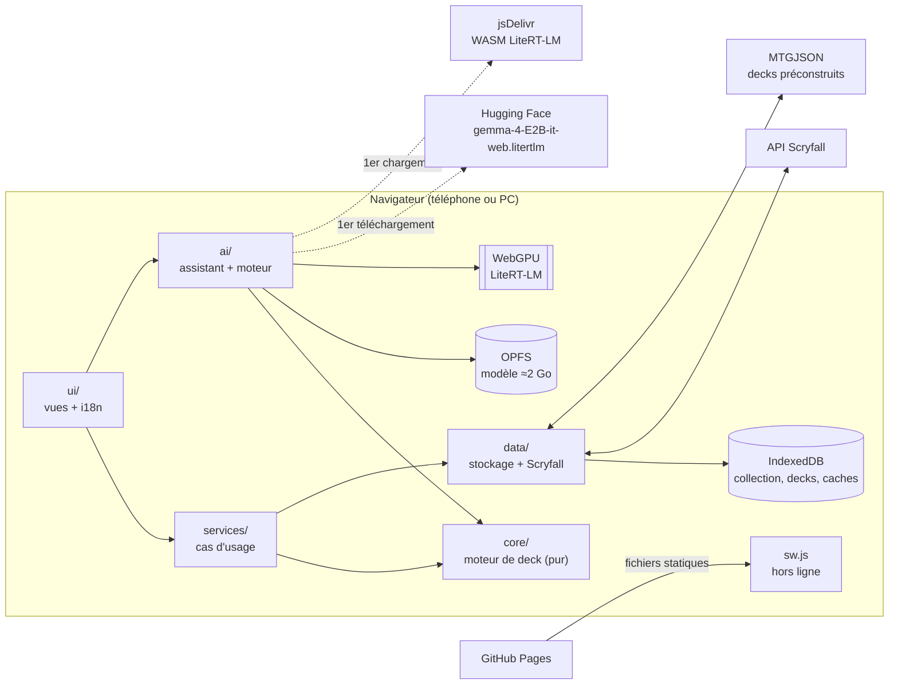
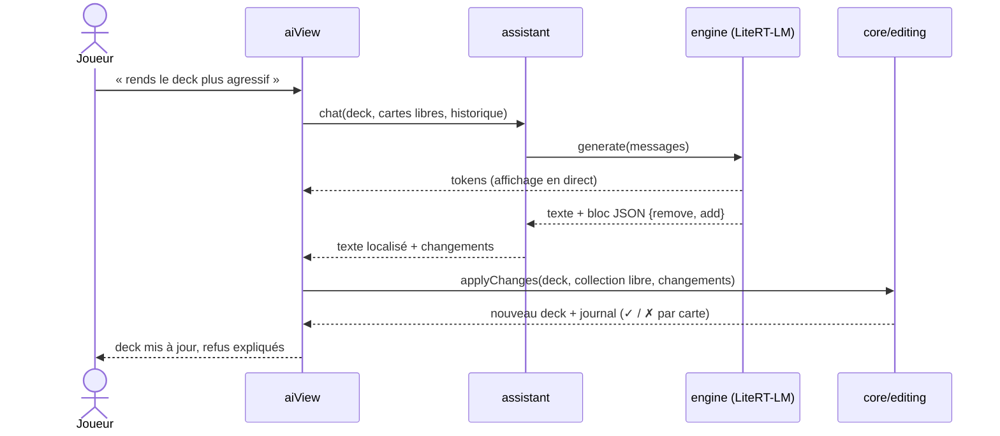
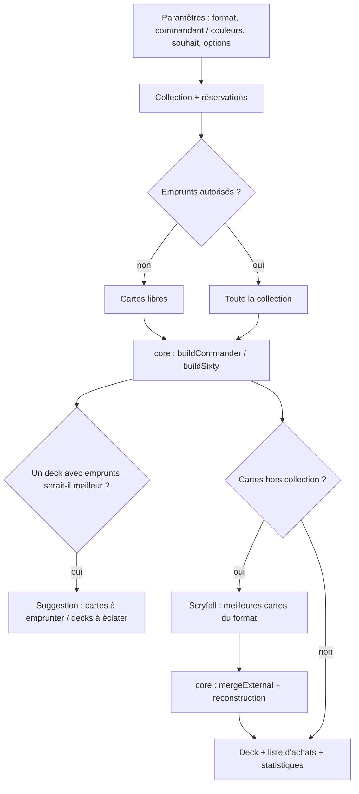

# Architecture — MTG Deck Builder

Web app **100 % côté client** (PWA) : aucun serveur à nous. Le navigateur parle directement à l'API Scryfall,
stocke la collection et les decks localement, et fait tourner l'IA (Gemma 4 E2B) sur le GPU de l'appareil.
L'hébergement est statique (GitHub Pages).

## Vue d'ensemble

## Couches

Règle de dépendance : **une couche n'importe que les couches en dessous d'elle.**
`core` ne connaît ni le DOM, ni le réseau, ni le stockage : c'est ce qui le rend testable et réutilisable.

| Couche | Dossier | Rôle | Dépend de |
|---|---|---|---|
| Interface | `src/ui/` | Vues (une par onglet), état partagé, textes FR/EN, fiche carte | services, ai, core |
| IA | `src/ai/` | Téléchargement du modèle, moteur LiteRT-LM, prompts, assistant | core, data (kv) |
| Services | `src/services/` | Cas d'usage : générer un deck (réservations, emprunts, cartes hors collection), importer, éditer, scanner, ajouter un deck préconstruit | core, data |
| Données | `src/data/` | IndexedDB (dépôts collection / decks), sauvegarde JSON, client Scryfall + cache | core (constantes) |
| Domaine | `src/core/` | Rôles des cartes, scores, souhaits, construction Commander / 60 cartes, validation des modifications | — |

### `core/` — le moteur de deck
- `cards.js` : rôle d'une carte (ramp, pioche, removal, wipe…) par expressions régulières sur le texte Oracle, qualité (rang EDHREC), sous-types, base de terrains.
- `wishes.js` : transforme un souhait libre (« elfes agressif », « tokens ») en profil de thèmes / tribus / style, puis en bonus de score.
- `builder.js` : construction déterministe.
  - **Commander** : quotas par rôle (10 ramp, 10 pioche, 8 removal, 2 wipes), synergies avec le commandant, 36 terrains.
  - **60 cartes** : 4 exemplaires max, courbe plafonnée (≤ 8 cartes à 4, ≤ 4 à 5, ≤ 2 à 6+), 24 terrains.
  - **Cartes hors collection** : fusion avec les meilleures cartes du format, pénalité pour chaque exemplaire à acheter.
- `builder.js` → `deckPower` : puissance affichée (popularité EDHREC moyenne des sorts, 0 à 100), distincte du score interne
  qui inclut les bonus de synergie / souhait / EDHREC et sert seulement à comparer les choix du moteur.
- `builder.js` → `rankCommanders` / `rankColors` : tous les commandants possibles (Commander) ou toutes les couleurs et paires de couleurs (60 cartes), du meilleur deck au moins bon (« 💡 Que puis-je construire ? » ; `bestCommander` prend le premier).
- `builder.js` → `deckFromList` : deck à partir d'une liste toute faite (deck préconstruit, decklist importée) ; format déduit des légalités, cartes non possédées marquées « à acheter ».
- `copies.js` : **exemplaires** d'une carte (extension, numéro, langue, foil, état, quantité, prix de l'impression). La collection reste rangée par nom
  (`quantity` = total des exemplaires), donc le moteur de deck et les réservations raisonnent toujours par carte ; les anciennes cartes
  sans exemplaires détaillés sont complétées à la lecture (un exemplaire de leur extension, état NM). Valeur = somme des exemplaires (prix foil compris).
- `upgrade.js` : améliorer un deck avec la collection (cartes faibles → meilleures cartes libres du même rôle) ; les échanges passent ensuite par `editing.js`.
  `budgetSuggestions` : même principe avec des cartes à acheter (les plus jouées du format et des couleurs, non possédées),
  chaque carte faible remplacée par la meilleure qui tient dans le budget restant ; les achats vont dans la liste d'envies.
- `hand.js` : main de départ (mélange, mulligan) et probabilités de terrains (loi hypergéométrique, exacte).
- `goldfish.js` : test « solitaire » — jouer seul les premiers tours (un terrain par tour, mana des terrains et des permanents de mana,
  sorts de rampe, commandant avec sa taxe), `autoTurn` (jeu automatique) et `goldfishStats` (bilan de centaines de parties).
- `partners.js` : commandants à deux (Partner, Partner with, Partner—groupe, Friends forever, Choose a Background + Background,
  Doctor's companion + Time Lord Doctor) : `partnerKind`, `canPair`, `partnersFor`, `commandZone(deck)`. Un deck à deux garde
  `deck.commander` et ajoute `deck.partner` ; `buildCommander(…, { partner })` prend l'identité, les thèmes et les tribus des deux
  (98 cartes en plus), `bestPartner` choisit le meilleur ; EDHREC lit la page du couple (`pairSlug`), sinon celle du principal.
- `loans.js` : cartes prêtées (à qui, combien, depuis quand). `loanReservations` les présente comme des réservations de deck :
  `decksRepo.reservations` les inclut, donc une carte prêtée n'est plus libre nulle part ; `withoutLoans` / `decksRepo.notLent`  les retire aussi
  quand on construit en prenant dans les autres decks. Stockées dans `kv` (clé `loans`) et incluses dans les sauvegardes.
- `wishlist.js` : liste d'envies (ajout sans doublon, ce qui manque encore, total) ; stockée dans `kv` et incluse dans les sauvegardes.
  Prix cible : `setWishTarget`, `withWishPrices` (garde l'ancien prix pour la flèche ↑ / ↓), `priceAlerts` ; les prix sont relus
  une fois par jour à l'ouverture de la liste (`wishlistService.refreshPrices`).
- `stats.js` : statistiques de la collection, doubles à échanger, historique de valeur (un relevé par jour), export CSV.
  Classeur d'échange : `tradeText` (doubles → « 2 Sol Ring (C21) »), partagé par lien `#trade=…` (`share.js`) ; à la réception,
  `sortTradeOffer` trie les cartes pour l'ami (sa liste d'envies, ce qu'il n'a pas, ce qu'il a) — vue `tradeView`.
  Extensions à compléter : `setProgress` (extensions entamées, les plus avancées d'abord) et `missingSummary` (manquantes d'un catalogue :
  par rareté, coût, déjà possédées ailleurs), affichés dans les statistiques et dans « Parcourir une extension ».
- `game.js` : compteur de partie (vie, poison, blessures de commandant, élimination, dés) ; chaque action renvoie une nouvelle partie.
  Fin de partie : `soleSurvivor` (dernier joueur en jeu), `gameRecord` (fiche pour l'historique), `historyStats` (victoires par deck et par joueur), `gameInsights`
  (durée moyenne, premier joueur, séries en cours, duels entre decks, éliminations par cause).
  L'historique est stocké dans `kv` (clé `gameHistory`, `services/gameHistoryService.js`) et inclus dans les sauvegardes.
- `decklist.js` : lecture d'une decklist collée (formats Arena, MTGO, Moxfield, Archidekt, liste simple ; sections ou blocs séparés par une ligne vide),
  et export (`formatDecklist` : Moxfield / Archidekt avec noms complets, ou Arena avec la face avant des cartes recto-verso).
- `share.js` : deck partagé par lien — la decklist est compressée (`CompressionStream`, deflate) dans l'adresse (`#deck=…`), sans serveur ;
  à l'ouverture, `main.js` la passe à l'import de decklist puis retire le code de l'adresse. Le même lien s'affiche aussi en QR code
  (bibliothèque `uqr`, chargée à la première utilisation).
- `formats.js` : `formatCheck` — cartes d'un deck plus légales dans son format, et premier format suivant (Standard → Pioneer → Modern →
  Legacy → Vintage) où tout est légal. `services/formatService.js` vérifie les decks enregistrés une fois par jour (légalités Scryfall),
  range le deck dans ce format et garde un avis dans « Mes decks » jusqu'à ce que le joueur le ferme (Commander, Pauper : avis seulement).
- `sideboard.js` : réserve des decks à 60 cartes (`deck.side`) : 15 cartes au plus, 4 exemplaires au total avec le deck ; ajouts validés,
  passage deck ↔ réserve, réserve proposée (`suggestSideboard` : contresorts, anti-artefacts / enchantements, anti-cimetière, balais,
  removal, dans les couleurs du deck). Réservée avec le deck, exportée en section « Sideboard », reprise à l'import.
- `combos.js` : range les combos trouvés par Commander Spellbook selon le deck actuel (complets, ou à une carte près — d'abord ceux que la collection permet de finir).
- `comboBase.js` : base des combos téléchargée — découpe au fil de l'eau du fichier complet de Commander Spellbook (≈690 Mo décompressé), forme compacte (index des cartes de chaque combo + textes par paquets), recherche des combos complets ou à une carte près (dans les couleurs du deck ; les « une carte avec… » ne sont pas vérifiables hors ligne).
- `editing.js` : applique des retraits / ajouts **en les validant** (possédée, libre, légale, couleurs, maximum). Utilisé par les boutons +/− *et* par l'IA.

> Le moteur est un portage exact de la version Python historique (`legacy/pc-flask/builder.py`, retirée du dépôt :
> `git show legacy-python:legacy/pc-flask/builder.py`).
> `tests/core/builder.test.js` vérifie que les deux produisent **les mêmes decks** sur une collection de référence.

### `data/` — stockage et Scryfall
- `db.js` : connexion IndexedDB (`mtg-deck-builder`, stores `collection`, `decks`, `kv`).
- `collectionRepo.js`, `decksRepo.js` : dépôts. Les **réservations** sont calculées à partir des decks enregistrés : une carte rangée dans un deck n'est plus « libre » (on ne réserve que les exemplaires possédés, pas ceux « à acheter »). Les terrains de base aussi sont réservés, et comptés
  comme les autres cartes si la collection en enregistre (`tracksBasics`) : `withBasicStock` passe « à acheter » ceux qui ne sont pas libres
  (le moteur les pose sans regarder la collection), et `borrowReport` propose de les emprunter. Collection sans terrains de base : illimités.
- `backup.js` : export / restauration JSON (compatible avec l'export de l'ancienne appli PC).
- `scryfall/` : `importer.js` (CSV/JSON, pur), `mappers.js` (objet Scryfall → carte compacte, versions FR), `client.js` (HTTP, ~10 req/s), `index.js` (enrichissement par paquets de 75, noms FR par paquets de 20, recherche, meilleures cartes d'un format avec cache d'une semaine, cartes par identifiant).
  `resolveDeckLines` (import de decklist) essaie dans l'ordre : extension + numéro (si le nom concorde), nom + extension, nom seul, puis recherche approchée (fautes de frappe, noms imprimés en français).
  Les cartes recto-verso sont cherchées par leur **face avant** : `/cards/collection` ne reconnaît pas le nom complet « A // B ».
  `rulings(nom)` : précisions de règles officielles d'une carte (fiche de la carte, chargées à l'ouverture de la rubrique, cache 30 jours).
- `edhrec.js` : synergies réelles d'un commandant d'après EDHREC (JSON public, CORS ouvert, cache 14 jours) : pour chaque carte, part des decks qui la jouent et synergie. Utilisées par `buildCommander` (bonus de score, facultatif : sans elles le moteur est identique à la version Python) et par « Améliorer avec ma collection ».
- `spellbook.js` : combos d'une liste de cartes d'après [Commander Spellbook](https://commanderspellbook.com) (`POST /find-my-combos`, cache 3 jours) : combos complets et à une carte près, avec étapes, conditions et légalités. Seulement à l'appui sur « ♾️ Combos ». **Leur serveur n'autorise (CORS) que leur site et `localhost`** : sur GitHub Pages, l'appel échoue (« Failed to fetch »).
- `comboBase.js` : la solution pour l'appli en ligne — leur fichier complet (`json.commanderspellbook.com/variants.json.gz`, CORS ouvert, ≈30 Mo) téléchargé à la demande, lu en flux et gardé compressé (≈6 Mo) dans le cache « mtg-combos » (index + paquets de 250 combos, lus seulement pour ceux qu'on affiche). Mise à jour sans perdre l'ancienne base ; supprimable. Utilisée en priorité par `deckService.deckCombos` quand elle est là.
- `storage.js` : espace utilisé par l'appli, mesuré partie par partie (fichiers de l'appli, moteurs, modèle de l'IA, images, données) ;
  affiché dans Plus → 💾 Stockage. Le service worker ne garde que des réponses CORS : une réponse « opaque » est comptée ≈7 Mo par Chrome.
- `mtgjson.js` : liste des decks préconstruits (Commander, démarrage…) et contenu d'un deck, d'après [MTGJSON](https://mtgjson.com) (CORS ouvert, cache 7 jours). Chaque carte porte son identifiant Scryfall : l'impression exacte est récupérée chez Scryfall.

### `ai/` — IA locale
- `models.js` : modèle utilisé (`gemma-4-E2B-it-web.litertlm`, ≈2 Go, le seul format compatible navigateur avec Gemma 4 E2B).
- `modelStore.js` : téléchargement dans **OPFS** (système de fichiers privé du navigateur) avec progression et **reprise** par requêtes `Range` si la connexion coupe ; repli sur le Cache API.
- `engine.js` : charge `@litert-lm/core` **à la demande** (import dynamique), crée le moteur à partir du fichier OPFS, sérialise les générations (une à la fois) et diffuse les tokens.
  Il note l'étape en cours (`localStorage`), seulement pendant que la page est visible : si le téléphone la tue faute de mémoire (iPhone surtout),
  le plantage est détecté au démarrage suivant (quitter ou fermer l'appli pendant le chargement n'en est pas un) ;
  la dernière erreur est gardée pour le bloc « Diagnostic » (Plus → IA locale).
- `prompts.js` (pur) : prompts courts adaptés à un petit modèle, extraction du bloc JSON d'échanges, suppression du raisonnement interne, **localisation** des noms de cartes (FR ↔ EN).
- `assistant.js` : analyse du deck et chat. Les échanges proposés ne sont **jamais** appliqués directement : ils passent par `core/editing.js`.

### `ui/`
- `state.js` : état partagé (langue, collection, deck courant, conversation) et abonnement aux changements de langue.
- `views/` : `collectionView` (liste ou tuiles, classement en dossiers), `buildView`, `decksView`, `moreView`, `aiView`, et les écrans plein écran `setBrowser` (catalogue d'une extension), `preconBrowser` (decks préconstruits), `deckImport` (import de decklist), `handView` (main de départ, dans « Construire »), `statsView` (statistiques), `wishlistView` (liste d'envies), `gameView` (onglet « Partie » : réglages et historique, puis table plein écran ; partie gardée en localStorage, écran maintenu allumé par Wake Lock), `scanner` (caméra, image figée, OCR / IA ; mode « deck » depuis Mes decks : les cartes vont dans une liste, pas dans la collection, puis « Créer le deck » la passe à `deckImport` qui propose la première légende scannée comme commandant et ajoute à la collection les exemplaires scannés qui y manquent), `comboView` (combos du deck, reclassés à chaque modification sans nouvelle requête), `comboBaseView` (base des combos : section de Plus, et bouton sous ♾️ Combos quand le serveur refuse). Chaque vue a un `init()` (branchement des événements) et des fonctions de rendu.
- `tour.js` : tutoriel (visite guidée qui éclaire chaque zone), lancé à la première visite puis par le bouton « ? ».
- `main.js` : assemble les vues, gère les onglets et enregistre le service worker.

## Flux de génération d'un deck

## Choix techniques

| Sujet | Choix | Pourquoi |
|---|---|---|
| Plateforme | PWA statique | Un seul code pour téléphone et PC, installable, hors ligne, hébergement gratuit. |
| Outillage | Vite + JavaScript (ES modules) | Build rapide, découpage automatique (le moteur IA n'est chargé qu'à l'usage), pas de framework à apprendre. |
| Stockage | IndexedDB (+ OPFS pour le modèle) | Gros volumes possibles, persistant ; OPFS lit le modèle depuis le disque sans tout charger en mémoire. |
| IA | LiteRT-LM + Gemma 4 E2B (WebGPU) | Bibliothèque officielle Google pour l'inférence navigateur ; MediaPipe LLM Inference n'est plus maintenu. E2B (≈2 Go) est le plus gros modèle raisonnable sur téléphone. |
| Fiabilité de l'IA | Sortie JSON + validation par `core` | Un modèle de 2 milliards de paramètres se trompe parfois (cartes inventées, JSON cassé) : le code reste maître des règles. |
| Données cartes | API Scryfall | Gratuite, sans clé, autorise les appels navigateur, fournit noms FR, légalités, prix et rang EDHREC. |
| Tests | Vitest + fake-indexeddb | Teste le domaine, les dépôts et l'assistant (moteur IA simulé) sous Node, en CI. |
| CI/CD | GitHub Actions → Pages | Tests et build à chaque push, déploiement automatique depuis `main`. |

## Limites connues
- **IA** : nécessite WebGPU (Chrome Android récent, Safari iOS 26+, Chrome/Edge PC) et ≈2 Go de stockage ; prévoir ~6 Go de RAM. LiteRT-LM JS est en préversion.
- **Qualité des decks** : le score repose sur la popularité EDHREC et, en Commander, sur les synergies EDHREC du commandant (s'il est connu d'EDHREC et qu'internet répond) ; les rôles des cartes (ramp, pioche…) restent devinés par expressions régulières.
- **Données locales** : effacer les données du navigateur efface la collection → exporter des sauvegardes.

## Pistes
- Fournisseur IA « Ollama sur le PC » (même interface que `engine.js`).
- Appels d'outils (tool calling) LiteRT-LM pour laisser l'IA interroger la collection.
- Migration progressive vers TypeScript.
